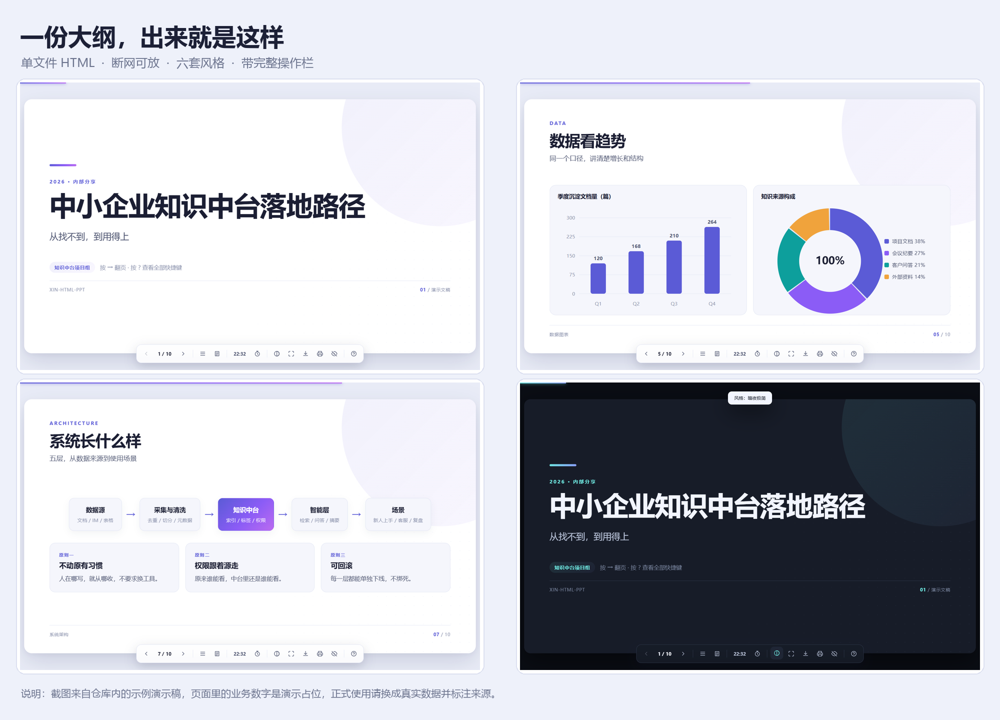
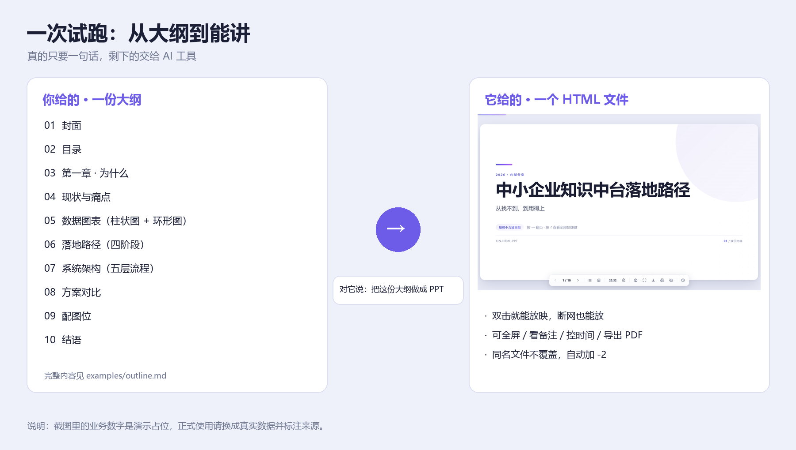
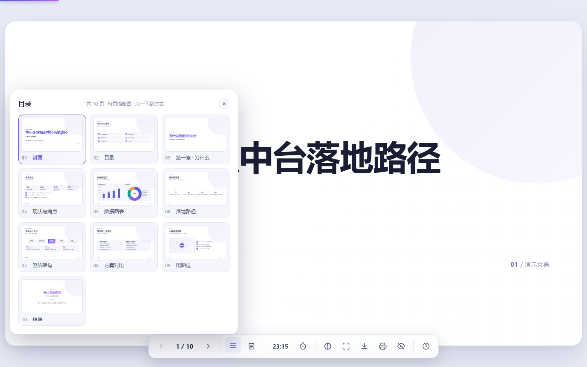
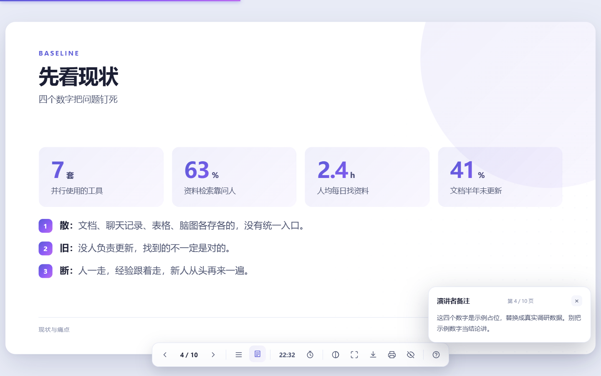

# xin-html-ppt

Turn an outline into a presentation you can open with a double-click.

No Office, no account, no internet while presenting. The result is **one HTML file** — send it to a colleague and it just opens.

[简体中文](README.md) · [Download the skill zip](dist/xin-html-ppt-skill.zip) · [Report an issue](https://github.com/oscar-wang-xin/xin-html-ppt/issues)



> These slides come from the sample outline in this repo. The business numbers are placeholders — replace them with real, sourced data before presenting.

## What it saves you

- **No slide-by-slide formatting.** Cover, contents, section breaks, charts and timelines are laid out in one pass.
- **No presentation software to install.** Any modern browser can show it, and it scales cleanly on a projector.
- **No "it won't open on my machine".** One file, no missing fonts, no version conflicts.
- **No starting over when things change.** Ask for a new colour, new numbers or one more page.

Useful for weekly and monthly reports, project proposals, retrospectives, training material, client decks and internal demos.

## Three steps

### 1. Install once

**Easiest: download the zip**

1. Click [Download the skill zip](dist/xin-html-ppt-skill.zip) and extract it. You get a folder named `xin-html-ppt`.
2. Put that whole folder in the right place for the tool you use:

| Your tool | Put the folder in |
| --- | --- |
| WorkBuddy | `~/.workbuddy/skills/` |
| GitHub Copilot in VS Code | `~/.copilot/skills/` |
| Claude Code | `~/.claude/skills/` |

`~` is your home folder: `C:\Users\<your-name>` on Windows, `/Users/<your-name>` on macOS. **Keep the folder name** `xin-html-ppt`.

**Sharing with your team:** with GitHub Copilot in VS Code, put the same folder in your project's `.github/skills/` and commit it — everyone who clones the repo gets it. That is Copilot's *project* skill location; `~/.copilot/skills/` above is the *personal* one, installed once and available in every workspace. Both paths follow the [VS Code Agent Skills documentation](https://code.visualstudio.com/docs/copilot/customization/agent-skills).

3. Restart your AI tool if it caches skills.

**If you prefer one command**

```bash
npx --yes github:oscar-wang-xin/xin-html-ppt
```

The installer detects which tools you have and installs for each. To target only Copilot:

```bash
npx --yes github:oscar-wang-xin/xin-html-ppt --tool copilot
```

This needs Node.js and git on your machine; agent tools such as WorkBuddy or Copilot normally ship Node. An existing install is never overwritten unless you add `--force`.

> Copilot users: open a fresh chat in VS Code, type `/` in the input, and you should see `xin-html-ppt` in the list. If it is not listed, plain language still works — just ask for a PPT.

### 2. Give it an outline

Paste text, or hand it a Markdown, Word, PDF or Excel file, then say:

> Turn this outline into a PPT — 10 slides, blue-violet, with a bar chart on the data page.

"Make 10 slides from this outline" is enough. There is a [sample outline](examples/outline.md) in this repo you can try first.



### 3. Double-click and present

You get one `.html` file: the name you asked for, or `html-ppt-<topic>.html`. Double-click it, hit the fullscreen button, and start talking. Send colleagues that single file.

An existing file is never overwritten — the new one gets `-2`, `-3`, and so on.

## The one you'll use most: a weekly status report

It is Friday afternoon and you need to walk your manager through the week. You know what you did; the slow part is laying it out as something you can project. Weekly and monthly reports are probably the most common decks of all — copy the whole block below.

**Paste this into your AI tool's chat** (once the skill is installed you don't need to name it, plain language triggers it):

```text
Make me a weekly status report, 8 slides, for my department head, clean and simple styling.

Outline:
1. Cover: Week 45 status report, presented by [your name]
2. Week at a glance: three workstreams, one finished, two in progress
3. What moved forward: knowledge base pilot, API integration done, docs completed
4. Progress comparison: a bar chart of completion for those three (80 / 65 / 95)
5. Blocker: third-party API times out occasionally
6. Next week: three items
7. Support needed: one item
8. Closing slide

Requirements: one speaker-note sentence per slide; keep the chart on slide 4 plain; name the file week-45-report.html.
```

> 80 / 65 / 95 are demo numbers — swap in your own. Every business figure in the sample deck is a placeholder; don't present it as fact.

You get a file called `week-45-report.html` that opens with a double-click. Before you start, open **Contents** to see a thumbnail of every slide and jump straight to the one you want; **Speaker notes** holds the one line you want to say on each slide, in a separate small window the audience never sees; set the **countdown** to 15 minutes and it will warn you near the end. Afterwards hit **Print** and save as PDF for a version you can file or share.

For a different occasion, just swap a few words in that prompt:

- Monthly retrospective: "A 10-slide monthly review: three things that worked and one that didn't, with a four-week timeline"
- Project status sync: "6 slides for a client, slide 3 compares plan vs actual with a bar chart, keep it restrained"
- Internal training: "12 slides from this agenda, speaker notes with talking points on every slide, three discussion questions at the end"

## The control bar

- **Previous / next:** click the arrows, or press `←` `→`.
- **Contents:** one click shows a thumbnail of every slide, with the current one highlighted; click a thumbnail to jump there.
- **Speaker notes:** what to say on this slide, in a separate small window that stays off the projected screen.
- **Clock and countdown:** pick 5 to 45 minutes, pause or reset, and get an alert when time is up.
- **Fullscreen:** one click to start presenting.
- **Export / print:** save a standalone HTML, export the outline, or print to PDF (one slide per page).
- **Hide the control bar:** tuck it away during a real presentation; press `h` to bring it back.

Also included: six colour themes with one-click switching, a progress bar, keyboard shortcuts and slide deep links via the URL hash.






More pages: [cover](docs/images/01-cover.png) · [data charts](docs/images/03-chart.png) · [four-stage timeline](docs/images/04-roadmap.png) · [architecture](docs/images/05-architecture.png) · [dark theme](docs/images/08-theme.png)

## Common questions

**Does it need the internet?** Not for presenting. Styles, charts and scripts all live inside the HTML — it works on a plane. Generating a deck uses your AI tool, so whether *that* needs a network depends on the tool.

**Do I need Office?** No. Any modern browser is enough.

**A colleague can't open it — what now?** Send the single HTML file, not a folder of assets and not screenshots.

**Can I use our company colours?** Yes. Ask for "dark blue", or click the theme button on the control bar — six themes are built in.

**Can I get a PDF?** Yes. Click Print and choose "Save as PDF".

**How do I put in real numbers?** Give the real data to the AI and ask for a new version. Every number in the sample deck is a placeholder; don't present it as fact.

**What if the computer has neither Python nor Node?** Presenting needs neither. Generation uses one of them, and the agent will ask you to install Python 3 or Node.js >= 16 if both are missing. Agent tools such as WorkBuddy or Copilot normally ship both.

---

## Advanced — safe to skip entirely

<details>
<summary>Installer flags, helper scripts, repository layout, maintainer commands</summary>

### What this actually is

Not a JS library. It is an **Agent Skill**: a `SKILL.md` instruction file, an HTML template, three reference documents, and twin Python/Node helper scripts. An AI assistant reads those files and does the work when you ask for a PPT. `bin/cli.js` only copies skill files into a tool's skills directory — no dependencies, no network, no build step.

### All installer flags

| Flag | What it does |
| --- | --- |
| `--target <dir>` | Install into `<dir>/xin-html-ppt`; overrides auto-detection |
| `--tool <id>` | `workbuddy`, `copilot`, `claude`, or a comma-separated list |
| `--all` | Install for every supported tool, creating directories if needed |
| `--force` | Replace an existing installation |
| `--dry-run` | Print planned actions without writing anything |
| `--list` | Show detected tools and install status |
| `--uninstall` | Remove the installed skill |
| `-h` / `-v` | Help / version |

Auto-detected roots: `~/.workbuddy/skills`, `~/.copilot/skills`, `~/.claude/skills`; if none exists, the WorkBuddy path is created. Once published to npm, the short form `npx --yes xin-html-ppt` works too — the `github:` form does not require an npm release.

### Runtime policy

**Python 3 is the primary path; the `.js` scripts are the no-Python fallback.** Both twins are kept in sync and produce identical results. When neither runtime is present, `SKILL.md` tells the agent to ask the user to install Python 3 or Node.js >= 16 — it does not install anything or improvise. Agent tools such as WorkBuddy or Copilot normally ship both runtimes; check each tool's own documentation for what it actually bundles.

| Situation | What you need |
| --- | --- |
| Present a generated deck | Any modern browser; no Node, no Python, no network |
| Install from a downloaded zip | Nothing |
| Install with `npx` | Node.js >= 16 (and git) |
| Run the helper scripts | Python 3 primary, Node.js >= 16 fallback |
| Rebuild `dist/*.zip` (maintainer) | Python 3 |

### Helper scripts

```bash
python scripts/new_deck.py --out . --title "2026 Product Roadmap"
python scripts/check_deck.py html-ppt-2026产品路线图.html

# No Python? Equivalent Node fallback
node scripts/new_deck.js --out . --title "2026 Product Roadmap"
node scripts/check_deck.js html-ppt-2026产品路线图.html
```

`check_deck` is the 24-point pre-delivery check: slide structure, all nine control-bar hooks, contents thumbnails, self-containment and chart data.

### Why zero external references

CSS, JS, SVG and font fallbacks are all inline; images must be base64 or shipped next to the HTML. No CDN, no web fonts, no remote scripts. Export grabs the live page via `outerHTML`, which only keeps working because nothing is loaded from outside.

### Repository layout

```
.
├── SKILL.md                      # skill entry point (frontmatter + workflow)
├── assets/deck-template.html     # zero-dependency 10-slide template (source, not output)
├── references/                   # layout snippets, themes, chart/visual spec
├── scripts/                      # new_deck / check_deck, .py and .js
├── bin/cli.js                    # zero-dependency npx installer
├── docs/images/                  # screenshots used on this page
├── tools/build_dist.py           # rebuilds the zip (maintainer, Python 3)
├── examples/outline.md           # sample outline (placeholder numbers)
├── dist/xin-html-ppt-skill.zip   # ready-to-download skill archive
├── package.json / LICENSE / README.md (Chinese) / README.en.md (English)
└── CONTRIBUTING.md / CHANGELOG.md / .gitignore / .gitattributes
```

Only `SKILL.md`, `assets/`, `references/`, `scripts/` and `LICENSE` are copied into an AI tool. The repository root *is* the skill root, so GitHub → Code → Download ZIP also works: `SKILL.md` sits at the top level, but the extracted folder is named `xin-html-ppt-main` — **rename it to `xin-html-ppt`**.

### Development (maintainers)

```bash
npm test
npm pack --dry-run
node bin/cli.js --target /tmp/skills --dry-run
python scripts/check_deck.py <deck.html>
node scripts/check_deck.js <deck.html>
python tools/build_dist.py          # rebuild the zip, including docs/images screenshots
```

Release: `git tag v1.0.3 && git push origin main --tags`. `npm publish --access public` is optional and enables the short `npx xin-html-ppt` form. Attach `dist/xin-html-ppt-skill.zip` to the GitHub Release for a versioned download.

### Optional visual skills

`ui-ux-pro-max`, `chart-infographic`, `archify` and `image-design-master` are third-party skills created by their own authors. `SKILL.md` treats them as **optional enhancements**: if any is unavailable, the deck falls back to built-in themes and inline SVG. This project does not bundle, copy or redistribute them — read their original repositories and licences before use, and respect the original authors.

</details>

## Contributing

See [CONTRIBUTING.md](CONTRIBUTING.md). Bug reports and PRs are welcome; keep the `SKILL.md` frontmatter valid and both `check_deck` twins green.

## License

MIT © 2026 Oscar Wang (王鑫). See [LICENSE](LICENSE).
