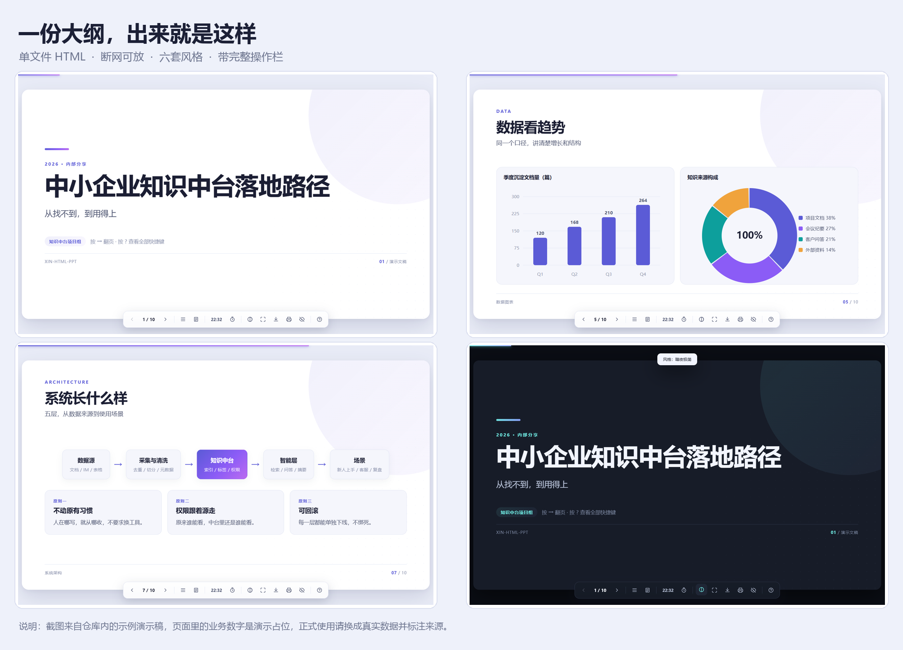
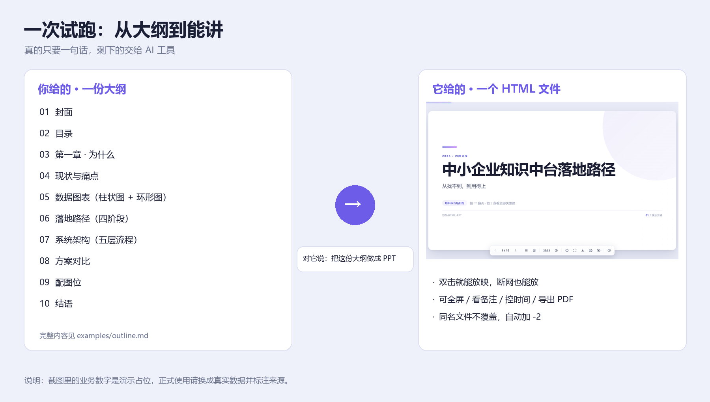
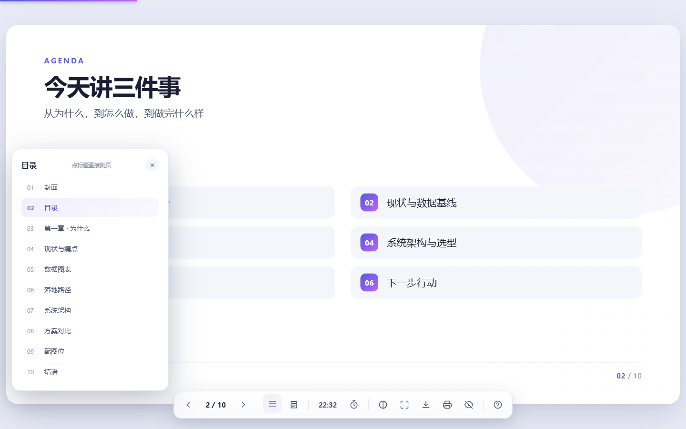
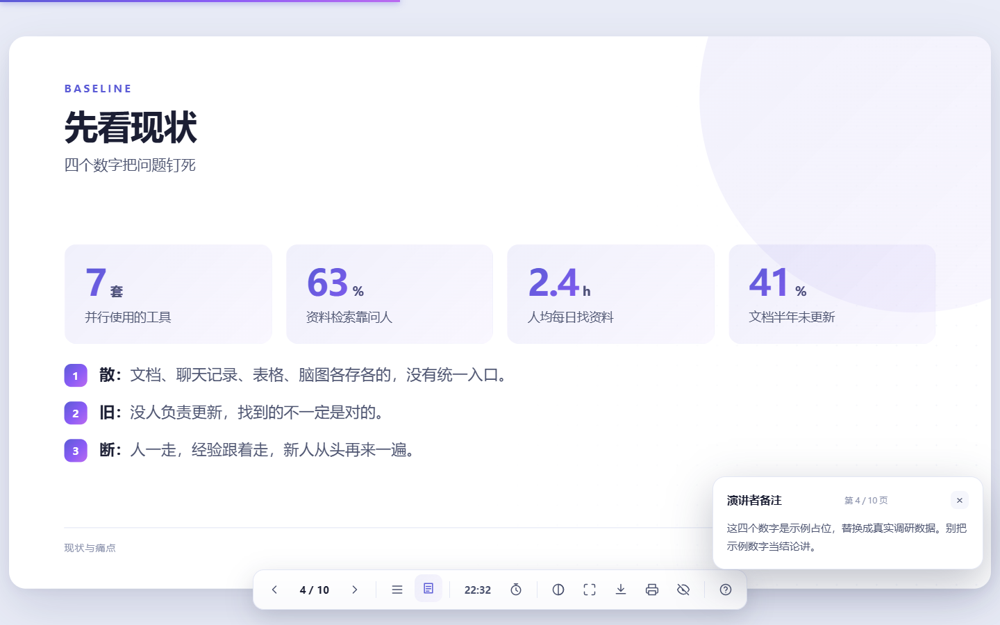

# xin-html-ppt

给一份大纲，出一份**双击就能放映的 PPT**。

不用装 Office，不用注册账号，放映时不用联网。成品只有一个 HTML 文件，发给同事，双击就能看。

[English](README.en.md) · [下载技能包](dist/xin-html-ppt-skill.zip) · [遇到问题](https://github.com/oscar-wang-xin/xin-html-ppt/issues)



> 上面四张都来自仓库里的示例大纲。页面中的业务数字是演示占位，正式使用请换成真实数据并标注来源。

## 它能替你省掉什么

- **不用一页页排版**：封面、目录、章节页、图表、时间轴，一次排好。
- **不用另装放映软件**：有浏览器就能讲，投屏也不会变形。
- **不用担心对方打不开**：一个文件发过去，不会有「字体丢了」「版本不兼容」。
- **改稿不用从头来**：换配色、换数据、加一页，说一句话就行。

周报月报、方案汇报、项目复盘、培训材料、客户提案、内部分享，都合适。

## 三步用起来

### 第一步 · 装一次，以后不用再管

**最省事：下载压缩包**

1. 点 [下载技能包](dist/xin-html-ppt-skill.zip)，解压得到一个叫 `xin-html-ppt` 的文件夹。
2. 按你平时用的工具，把整个文件夹放进对应位置：

| 你用的工具 | 放到哪里 |
| --- | --- |
| WorkBuddy | `~/.workbuddy/skills/` |
| VS Code 里的 GitHub Copilot | `~/.copilot/skills/` |
| Claude Code | `~/.claude/skills/` |

`~` 是你的用户目录：Windows 上是 `C:\Users\你的用户名`，Mac 上是 `/Users/你的用户名`。**文件夹名字别改**，就叫 `xin-html-ppt`。

**想全组共用**：用 VS Code 里的 GitHub Copilot 时，把同一个文件夹放进项目根目录的 `.github/skills/`，随仓库提交，同事拉下来就都有。那是 Copilot 的「项目技能」；上面 `~/.copilot/skills/` 是「个人技能」，装一次、所有项目都能用。这两条路径依据 [VS Code 官方文档](https://code.visualstudio.com/docs/copilot/customization/agent-skills)。

3. 重启一下 AI 工具（有些工具会缓存技能）。

**会敲命令的话，一行装完**

```bash
npx --yes github:oscar-wang-xin/xin-html-ppt
```

它会自动认出你装了哪些工具并装好。只想装给 Copilot：

```bash
npx --yes github:oscar-wang-xin/xin-html-ppt --tool copilot
```

这条需要本机有 Node.js 和 git。WorkBuddy、Copilot 这类工具一般自带 Node。已经装过的不会覆盖，想换新版加 `--force`。

> 用 Copilot 的同事：装完在 VS Code 里开个新对话，输入框打 `/` 能看到 `xin-html-ppt`，就说明装好了。看不到也别慌，直接说人话同样会触发。

### 第二步 · 把大纲给它

粘贴文字，或者给它一个 Markdown / Word / PDF / Excel 文件，然后说：

> 把这份大纲做成 PPT，10 页，蓝紫色，数据那页放个柱状图

想省事，一句「按这份大纲做 10 页 PPT」也够。仓库里有份 [示例大纲](examples/outline.md)，可以直接拿去试跑。



### 第三步 · 双击打开就能讲

生成的是一个 `.html` 文件：你指定的名字，或者 `html-ppt-<主题>.html`。双击用浏览器打开，点底下的全屏按钮就能开讲。发给同事，就发这一个文件。

同名文件不会被覆盖，自动变成 `…-2.html`。

## 最常用的一次：把这周干的活变成一份汇报

周五下午要跟负责人过一遍这周做的事。内容心里有数，费时间的是把它排成一份能投屏的稿子。周报、月报大概是做得最多的一种 PPT，下面这段可以直接整段复制。

**把这段话复制进 AI 工具的对话框**（技能装好后不用说技能名，直接说人话就会触发）：

```text
帮我做一份本周工作汇报，8 页，给部门负责人看，风格简洁清爽。

大纲：
1. 封面：第 45 周工作汇报，汇报人【填你的名字】
2. 本周概览：三件事，一件收尾、两件在推进
3. 重点进展：知识库试运行、接口联调完成、操作文档补齐
4. 进度对比：用柱状图展示这三项的完成度（80 / 65 / 95）
5. 遇到的卡点：第三方接口偶发超时
6. 下周计划：三项
7. 需要支持：一项
8. 结束页

要求：每页写一句演讲者备注；第 4 页的图表别太花；文件名叫 第45周工作汇报.html。
```

> 上面 80 / 65 / 95 是演示数字，换成自己的再拿去讲。示例稿里所有业务数字都是占位，别照抄进真实汇报。

它会给你一个叫 `第45周工作汇报.html` 的文件，双击就能放。讲之前点一下「目录」能跳到任意一页，「备注」里是每页要说的那句话（单独小窗，投屏上看不到），「倒计时」设成 15 分钟，快到点会提醒。讲完点「打印」存成 PDF，发群里就是一份能归档的版本。

换个场合不用重写，把提示词里那几句换掉就够了：

- 月度复盘：「做一份 10 页月度复盘，重点讲三件做成的事和一件没做成的，用时间轴展示四周节奏」
- 项目进度同步：「做 6 页给客户看的进度同步，第 3 页用柱状图对比计划和实际，风格稳重些」
- 内部分享或培训：「按这份提纲做 12 页讲义，每页备注写讲解要点，最后一页留三道讨论题」

## 讲的时候，底下那一排能干什么

- **翻页**：点左右箭头，或按 `←` `→`。
- **目录**：点一下列出全部页面，想去第几页点第几页。
- **演讲者备注**：这一页要讲什么，单独一个小窗，不挡投屏画面。
- **时钟和倒计时**：5 到 45 分钟随便选，能暂停能重置，到点提醒，控时间很有用。
- **全屏**：一键进入放映。
- **导出 / 打印**：存成单个 HTML、导出大纲，或打印成 PDF（一页一张）。
- **收起操作栏**：正式放映时把这一排藏起来，按 `h` 再叫出来。

另外还能一键换六套配色、看进度条、用键盘快捷键。






想看别的页面：[封面](docs/images/01-cover.png) · [数据图表](docs/images/03-chart.png) · [四阶段时间轴](docs/images/04-roadmap.png) · [系统架构](docs/images/05-architecture.png) · [深色主题](docs/images/08-theme.png)

## 大家最常问的

**要联网吗？** 放映不用。样式、图表、脚本全在那个 HTML 里，飞机上也能放。生成时用的是 AI 工具本身，它需不需要联网看你的工具。

**要装 Office 吗？** 不用，任意现代浏览器就行。

**同事打不开怎么办？** 发那一个 HTML 文件给他，别拆文件夹、别只发截图。

**能换成公司配色吗？** 能。跟 AI 说「换成深蓝」，或点操作栏的风格按钮，一共六套。

**能导出 PDF 吗？** 能。点「打印」，目标选「另存为 PDF」。

**数据怎么换成真的？** 把真实数据给 AI，让它重出一版。示例稿里的数字全是占位，别拿去汇报。

**电脑上没有 Python 或 Node 怎么办？** 放映完全不需要。生成时 AI 会用到其中一个，两个都没有它会提示你装一个；WorkBuddy、Copilot 这类工具一般自带。

---

## 进阶：想自己折腾再看（这段可以整段跳过）

<details>
<summary>命令参数、脚本、目录结构、开发自检</summary>

### 这是什么

不是 JS 库，是一份 **Agent Skill**：`SKILL.md` 说明 + HTML 模板 + 三份参考规范 + Python/Node 两套辅助脚本。AI 工具读到这些文件，你说「做成 PPT」，它照着做。`bin/cli.js` 只负责把技能文件复制进工具的 skills 目录，零依赖、不联网、不构建。

### 安装器全部参数

| 参数 | 作用 |
| --- | --- |
| `--target <dir>` | 装到 `<dir>/xin-html-ppt`，优先于自动探测 |
| `--tool <id>` | `workbuddy`、`copilot`、`claude`，可逗号分隔 |
| `--all` | 所有支持的工具都装，目录不存在就建 |
| `--force` | 覆盖已有安装 |
| `--dry-run` | 只打印会做什么，不写文件 |
| `--list` | 列出工具探测结果与安装状态 |
| `--uninstall` | 卸载 |
| `-h` / `-v` | 帮助 / 版本 |

自动探测的目录：`~/.workbuddy/skills`、`~/.copilot/skills`、`~/.claude/skills`。一个都没找到就建 WorkBuddy 那个。等包发到 npm 后可用短写法 `npx --yes xin-html-ppt`；`npx --yes github:...` 不需要先发 npm 包。

### 运行时口径

**Python 3 是主路径，`.js` 脚本是没有 Python 时的兜底。** 两套脚本结果逐项一致。两个运行时都没有时，`SKILL.md` 要求 AI 提示用户安装 Python 3 或 Node.js >= 16，不擅自安装、不手工硬扛。WorkBuddy、Copilot 这类 agent 工具一般自带两者；这条按常规环境说明，各家工具实际内置什么请以官方文档为准。

| 场景 | 需要什么 |
| --- | --- |
| 放映生成的演示稿 | 任意现代浏览器，不需要 Node / Python / 联网 |
| 下载 zip 手动安装 | 什么都不需要 |
| 用 `npx` 安装 | Node.js >= 16（加 git） |
| 跑辅助脚本 | 优先 Python 3，缺则 Node.js >= 16 |
| 重建 `dist/*.zip`（维护者） | Python 3 |

### 辅助脚本

```bash
python scripts/new_deck.py --out . --title "2026 产品路线图"
python scripts/check_deck.py html-ppt-2026产品路线图.html

# 没有 Python 时的等价兜底
node scripts/new_deck.js --out . --title "2026 产品路线图"
node scripts/check_deck.js html-ppt-2026产品路线图.html
```

`check_deck` 是交付前 23 项校验：页面结构、九项操作栏、自包含性、图表数据。

### 为什么坚持零外链

CSS、JS、SVG、字体回退全部内联，配图必须 base64 内嵌或随文件同目录交付。没有 CDN、外链字体、远程脚本。导出走 `outerHTML` 抓取当前页面，也正因为零外链才不会当场失效。

### 目录结构

```
.
├── SKILL.md                      # 技能入口：frontmatter + 工作流
├── assets/deck-template.html     # 零依赖 10 页模板（源码，不是产物）
├── references/                   # 版式片段、主题变量、图表与配图规范
├── scripts/                      # new_deck / check_deck 的 .py 与 .js
├── bin/cli.js                    # 零依赖 npx 安装器
├── docs/images/                  # 本页用到的效果与案例截图
├── tools/build_dist.py           # 重建分发 zip（维护者，需 Python 3）
├── examples/outline.md           # 示例大纲（数字是占位）
├── dist/xin-html-ppt-skill.zip   # 可直接下载的技能包
├── package.json / LICENSE / README.md（中文） / README.en.md（English）
└── CONTRIBUTING.md / CHANGELOG.md / .gitignore / .gitattributes
```

真正被复制进 AI 工具的只有 `SKILL.md`、`assets/`、`references/`、`scripts/` 和 `LICENSE`。仓库根就是技能根，GitHub → Code → Download ZIP 解压后 `SKILL.md` 在顶层；那个包解压出来的目录叫 `xin-html-ppt-main`，**记得改名成 `xin-html-ppt`**。

### 开发与自检（维护者）

```bash
npm test
npm pack --dry-run
node bin/cli.js --target /tmp/skills --dry-run
python scripts/check_deck.py <deck.html>
node scripts/check_deck.js <deck.html>
python tools/build_dist.py          # 重建分发 zip，含 docs/images 里的截图
```

发布：`git tag v1.0.3 && git push origin main --tags`；`npm publish --access public` 是可选的，发了才有 `npx xin-html-ppt` 短写法；把 `dist/xin-html-ppt-skill.zip` 挂到 GitHub Release 即可提供带版本号的压缩包。

### 可选的美化技能

`ui-ux-pro-max`、`chart-infographic`、`archify`、`image-design-master` 都是各自作者做的第三方技能。`SKILL.md` 只把它们当**可选增强**：任何一个调不通，立刻降级到内置主题和内联 SVG。本项目不打包、不复制、也不分发这些技能；用之前请去看它们各自的仓库和许可，尊重原作者，别拿来主义。

</details>

## 参与贡献

见 [CONTRIBUTING.md](CONTRIBUTING.md)。提 issue 和 PR 都欢迎，前提是 `SKILL.md` 的 frontmatter 合法、两套 `check_deck` 都全绿。

## 许可

MIT © 2026 Oscar Wang (王鑫)，见 [LICENSE](LICENSE)。
